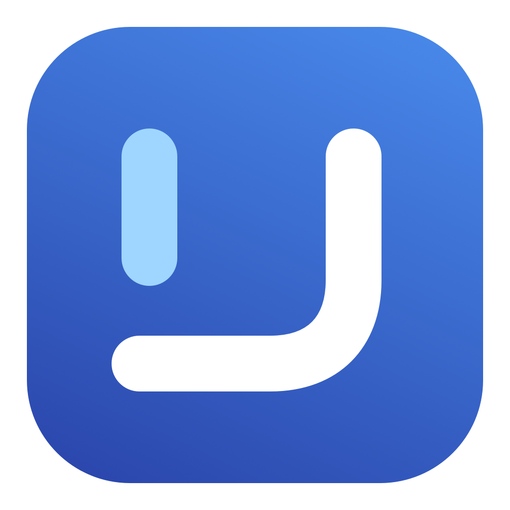

<p align="center">
  <picture>
    <source media="(prefers-color-scheme: dark)" srcset="docs/assets/README_Wordmark_Dark.svg">
    
  </picture>
</p>

<p align="center">Keep your Mac awake while your agents and renders work.</p>

<p align="center"></p>

<p align="center">
<a href="https://github.com/Kian-hdr/longhaul/releases/download/v1.0.0/Longhaul-1.0.0-arm64.dmg"></a>
</p>

<p align="center"><a href="https://github.com/Kian-hdr/longhaul/releases/download/v1.0.0/Longhaul-1.0.0-arm64.dmg">DMG · Apple silicon · v1.0.0</a></p>

<p align="center"><a href="#install">Install with Homebrew</a> · <a href="https://github.com/Kian-hdr/longhaul/releases/tag/v1.0.0">Release notes</a></p>

**Requires macOS 26 or later and Apple silicon.** Free software under
[GPL-3.0-only](LICENSE), created by Kian Konrad.

Longhaul is a native macOS utility that starts sleep protection when a supported
task is active and releases it after the work finishes. It also asks cooperating
applications to save recoverable progress as the battery runs low.

## Install

Download the signed and notarized [v1.0.0 DMG](https://github.com/Kian-hdr/longhaul/releases/tag/v1.0.0),
open it, and move Longhaul to Applications. The release also includes a ZIP,
`SHA256SUMS`, and matching source. See the [release status](docs/STATUS.md)
for verification and coverage limits.

[Installation and removal](docs/installation.md) covers verification and setup.
To have an AI agent install and configure Longhaul, give it the complete
[setup prompt](SETUP-PROMPT.md). Homebrew installation is also available:

```sh
brew install --cask kian-hdr/apps/longhaul
```

## Automatic task protection

Open Longhaul, leave **Automatic protection** enabled, and check **Integrations**.
A supported active task appears in Activity; an actual protection indicator
confirms that Longhaul has acquired its hold. When the last job finishes, Longhaul
releases protection after the completion grace, normally two minutes. Waiting for
a model or tool counts as work. Waiting for user input has a bounded grace period.

| Work source | How it is detected |
| --- | --- |
| Codex Desktop | Native lifecycle monitoring is on by default and can discover tasks that were already running. The qualified native format is Codex 0.153.4. Per-profile hooks provide additional lifecycle reporting after Codex trusts their exact definitions. |
| Terminal commands and other CLI agents | Run the foreground command through `longhaul run -- COMMAND ARGS`. Longhaul follows its process and exit. Detached work needs an explicit adapter. |
| Blender | The included add-on reports render lifecycle and completed frames, and can save a recovery scene copy. |
| DaVinci Resolve | Optional local scripting bridge. Availability depends on the installed edition and scripting access; real export/recovery qualification is pending. |
| Nodebay | Optional local companion controls and reporting for Nodebay's supported worker jobs. Both apps work independently. |

An open app, high CPU use, or an installed hook file is not proof of an active
protected task. Unsupported Codex formats and unverified writers are shown as
unavailable. Longhaul does not automatically understand every AI agent. See the
[integration guide](Resources/INTEGRATIONS.md) for setup and detection limits.
Use the copy-ready [agent task recipe](docs/agent-task.md) for supervised work and
honest checkpoint reporting.

After installing the command tool from Integrations:

```sh
longhaul run -- python3 my_job.py
```

Closing Longhaul's window keeps it running. **Pause** releases protection without
killing jobs. **Quit** releases Longhaul's owned holds. The menu bar and optional
Nodebay controls expose the same policy. Login launch is optional.

## Battery and closed-lid work

Ordinary protection prevents idle system sleep while allowing the display to
turn off. **Continue reported jobs with the lid closed** is an optional,
**experimental** feature, initially off. Enable it with the lid open and wait for
active protection before closing it.

**Battery auto-release** selects a cutoff from 1% to 100%, default 20%. Protection
continues at the selected percentage and releases below it. Switching the cutoff
off remembers your percentage and removes numeric battery/runtime withdrawal.
It does not disable macOS emergency handling, temperature checks, known-sensor
requirements, manual sleep, job completion or lease expiry. Release permits macOS
to sleep; it does not shut the Mac down.

One attended AC test passed with a 113-second lid closure and observed native
Codex progress. Physical battery operation, unattended overnight use and
uninterrupted execution of every task have not been qualified. The mechanism uses
shared runtime state without a kernel-owned lease; simultaneous helper failure
can leave unresolved cleanup. Read the [qualification and limitations](docs/lid-qualification-probe.md).
OS updates require requalification. Keeping the Mac awake does not unlock its
desktop or grant Computer Use access. Use a ventilated work surface.

Warnings and checkpoint requests can occur before protection releases. With
closed-lid mode disabled, the ordinary reserve is 10% or 10 estimated minutes.
A checkpoint acknowledgement proves reported files were saved, not that every
application can resume an interrupted computation. Keep independent backups.

## Build and contribute

Source builds require Xcode 26+, its command-line tools and XcodeGen.

```sh
./script/test_all.sh
./script/build_and_run.sh --build-only
```

Use `--build-only` while the installed app protects work. A normal run/replacement
must first release its existing holds in a controlled update with the lid open.
See [release engineering](docs/release.md) and [verification](docs/verification-review.md).

The repository includes original app/icon source, a command helper, lifecycle
adapters, tests and build scripts. There are no fetched Swift packages. The
[cooperative coordination prototype](docs/coordination-prototype.md) is a separate
state machine, not enforcement of native agent GUI actions.

[Privacy](PRIVACY.md) · [Security](SECURITY.md) ·
[Report an issue](https://github.com/Kian-hdr/longhaul/issues) ·
[License inventory](LICENSE-STATUS.md)

Copyright © 2026 Kian Konrad. Distributed without warranty; see [LICENSE](LICENSE).
